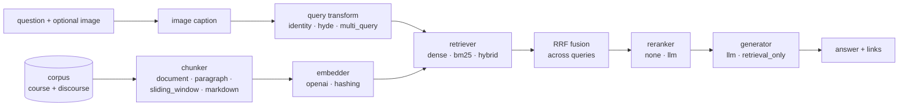

# Virtual TA — a RAG research lab

A modular Retrieval-Augmented Generation system that answers student questions for the
IIT Madras **Tools in Data Science (TDS)** course, built to make it cheap to try a new
RAG idea and measure whether it helped.

- **Every stage is pluggable**: chunking, embeddings, retrieval, query transformation,
  reranking and generation are each chosen by name in a YAML config.
- **Experiments are reproducible**: each evaluation run saves its exact config,
  per-question results and summary metrics under `runs/`.
- **Iteration is cheap**: embeddings are cached on disk by content hash, so changing the
  retriever or reranker costs nothing, and changing the chunker only embeds new chunks.
- **Ready to serve**: the same pipeline runs behind a FastAPI endpoint, in Docker, with
  tests and CI.



## Quickstart

Requires Python 3.11+ and [uv](https://docs.astral.sh/uv/).

```bash
uv sync                       # create .venv and install everything
cp .env.example .env          # then set API_KEY
uv run pytest                 # offline test suite

# No API key needed: hashing embeddings + BM25, retrieval only
uv run vta eval configs/experiments/offline.yaml --retrieval-only

# Full pipeline
uv run vta ask "Should I use Docker or Podman for this course?" -v
```

`API_KEY` can be an [AI Pipe](https://aipipe.org) token (the default `API_BASE_URL`) or
an OpenAI key with `API_BASE_URL=https://api.openai.com/v1`. Any OpenAI-compatible server
(vLLM, Ollama, LiteLLM, ...) works too.

## Running experiments

```bash
# Compare several approaches on the eval set in one go
uv run vta eval configs/baseline.yaml configs/experiments/hybrid.yaml configs/experiments/hyde.yaml

# Retrieval metrics only: skips generation and the judge, so it is fast and cheap
uv run vta eval configs/experiments/*.yaml --retrieval-only

# Tabulate every saved run
uv run vta compare
uv run vta compare --filter hybrid --last 5
```

```
run                            fingerprint  n   err  hit@k   recall@k  mrr     rubric  p50 s
-----------------------------  -----------  --  ---  ------  --------  ------  ------  -----
20261011-221512_offline        9627fda62a   13  0    0.9167  0.875     0.9167  -       0.001
```

Each run writes `runs/<timestamp>_<name>/`:

| file            | contents                                                              |
| --------------- | --------------------------------------------------------------------- |
| `config.yaml`   | the fully-resolved experiment config                                  |
| `results.jsonl` | per question: answer, queries, retrieved chunk ids and scores, metrics, judge verdicts, timings |
| `summary.json`  | aggregate metrics, config fingerprint, latency                        |

The **fingerprint** is a hash of everything except the name, so two runs with the same
fingerprint used the same pipeline.

### Metrics

| metric       | meaning                                                                       |
| ------------ | ----------------------------------------------------------------------------- |
| `hit@k`      | fraction of questions where at least one expected doc is in the top-k contexts |
| `recall@k`   | fraction of expected docs found in the top-k, averaged over questions         |
| `mrr`        | mean reciprocal rank of the first expected doc                                |
| `rubric`     | fraction of rubric criteria the LLM judge marks as satisfied (`--judge-model`) |
| `p50 s`      | median end-to-end latency per question                                        |

Retrieval metrics are computed at the **document** level, so several chunks from one doc
count once. That keeps chunking strategies comparable.

### The eval set

`eval/dataset.yaml` holds labelled questions. Each has the corpus doc ids that answer it
(`expected_docs`) and natural-language `rubric` criteria for the judge. Unanswerable
questions leave `expected_docs` empty and check that the bot admits it doesn't know. A
test verifies that every `expected_docs` id exists in the corpus.

**13 questions is enough to catch regressions, not to rank close approaches.** Growing the
dataset is the highest-leverage research work in this repo; add every failure you find.

## Configs

Shipped experiments live in `configs/experiments/`:

| config                    | idea                                                          |
| ------------------------- | ------------------------------------------------------------- |
| `baseline.yaml`           | paragraph chunks + dense retrieval (the served default)       |
| `v0_document_dense`       | whole-document embeddings, as in the original prototype       |
| `bm25`                    | lexical only                                                   |
| `markdown_dense`          | heading/post-aware chunking                                   |
| `window_dense`            | fixed sliding windows with overlap                            |
| `hybrid`                  | dense + BM25 with reciprocal rank fusion                       |
| `hybrid_rerank`           | hybrid top-20, then LLM listwise rerank to top-5              |
| `hyde`                    | Hypothetical Document Embeddings                              |
| `multi_query_hybrid`      | LLM query paraphrases, each retrieved and fused (RAG-Fusion)  |
| `hybrid_term_filter`      | hybrid, restricted to the question's term                     |
| `hybrid_live_sessions`    | hybrid, with live-session notes added to the corpus           |
| `offline`                 | no API calls at all, for smoke tests and CI                    |

A config is a list of `{name, params}` components; omitted fields take the defaults in
`src/virtual_ta/config.py`:

```yaml
name: my_experiment
description: What hypothesis this tests.
corpus:    {sources: [course, discourse], terms: null}   # e.g. terms: [2025-01]
chunker:   {name: markdown, params: {max_words: 250, min_words: 20}}
embedder:  {name: openai, params: {model: text-embedding-3-large}}
retriever: {name: hybrid, params: {dense_weight: 1.0, sparse_weight: 0.5}}
query_transform: {name: identity}
reranker:  {name: llm, params: {model: gpt-4o-mini}}
generator: {name: llm, params: {model: gpt-4o-mini, temperature: 0}}
candidate_k: 20    # retrieved before reranking
top_k: 5           # passed to the generator and scored by hit@k
max_links: 3       # links in the API response
term_filter: false # restrict retrieval to the question's term, when given
image_model: gpt-4o-mini   # captions attached images for retrieval; null disables
```

`uv run vta components` lists every registered component.

## Adding a new approach

Write a class, register it, and reference it from a config. No pipeline changes needed.

```python
# src/virtual_ta/retrieval.py (or any module imported by the package)
@RETRIEVERS.register("title_boost")
class TitleBoostRetriever(Retriever):
    def __init__(self, embedder, boost: float = 2.0):
        self.inner = DenseRetriever(embedder)
        self.boost = boost

    def fit(self, chunks, progress=False):
        self.chunks = chunks
        self.inner.fit(chunks, progress)

    def search(self, query, k):
        hits = self.inner.search(query, k * 3)
        terms = set(query.lower().split())
        for h in hits:
            h.score += self.boost * len(terms & set(h.chunk.title.lower().split()))
        return sorted(hits, key=lambda h: -h.score)[:k]
```

```yaml
retriever: {name: title_boost, params: {boost: 0.05}}
```

| stage           | registry           | base class       | constructor receives         |
| --------------- | ------------------ | ---------------- | ---------------------------- |
| chunking        | `CHUNKERS`         | `Chunker`        | params                       |
| embeddings      | `EMBEDDERS`        | `Embedder`       | `settings`, params           |
| retrieval       | `RETRIEVERS`       | `Retriever`      | `embedder`, params           |
| query transform | `QUERY_TRANSFORMS` | `QueryTransform` | `settings`, params           |
| reranking       | `RERANKERS`        | `Reranker`       | `settings`, params           |
| generation      | `GENERATORS`       | `Generator`      | `settings`, params           |

Corpus sources are plain functions in `documents.SOURCES` that map a directory to
`Document`s.

Ideas not yet implemented: cross-encoder rerankers (e.g. `bge-reranker`), local
sentence-transformer embeddings, contextual chunk headers (prepend an LLM summary of the
parent doc), parent-document retrieval, MMR diversification, metadata filters
(course vs forum, staff posts only), answer-faithfulness metrics, and a held-out test
split once the dataset is large enough.

## Serving

```bash
uv run vta serve -c configs/baseline.yaml          # http://127.0.0.1:8000/docs
```

```bash
curl -X POST http://127.0.0.1:8000/api/ -H "Content-Type: application/json" \
  -d '{"question": "Should I use Docker or Podman?"}'
```

```json
{
  "answer": "The course recommends Podman, but Docker works the same way [1].",
  "links": [{"url": "https://tds.s-anand.net/#/docker", "text": "Containers: Docker, Podman: ..."}]
}
```

`POST /api/` takes `{"question": str, "image": base64 | null, "term": "2025-01" | null}`. `GET /health` reports the
experiment being served and its fingerprint. Upstream model failures return `502`.

### Docker

```bash
docker build -t virtual-ta .
docker run -p 8000:8000 --env-file .env -v vta-cache:/cache virtual-ta
# serve a different experiment:
docker run ... -e VTA_CONFIG=configs/experiments/hybrid.yaml virtual-ta
```

The `/cache` volume keeps embeddings between restarts. Without it, every cold start
re-embeds the corpus.

An end-to-end [promptfoo](https://promptfoo.dev) suite against the running API lives in
`eval/promptfoo.yaml`: `npx promptfoo eval -c eval/promptfoo.yaml`.

## Data

Everything is organised **term by term**. IITM runs three terms a year, identified by
their start month, the same ids the course repository uses:

| id        | term      | Discourse tag  |
| --------- | --------- | -------------- |
| `YYYY-01` | Jan – Apr | `term1-YYYY`   |
| `YYYY-05` | May – Aug | `term2-YYYY`   |
| `YYYY-09` | Sep – Dec | `term3-YYYY`   |

```
data/
  raw/discourse/topics/<id>.json       full mirror of the tds-kb category (gitignored)
  corpus/course/<term>/...md           course notes for that term
  corpus/live_sessions/<term>/...md    FAQ summaries of recorded live sessions
  corpus/discourse/<term>/...md        one file per (forum topic, term) (gitignored)
```

**Forum content is not in the repository.** The Discourse forum is login-only, so both the
raw mirror and the built corpus are gitignored. After cloning, run `vta scrape discourse`
with your own `DISCOURSE_COOKIE` to build them locally.

Every corpus file starts with YAML front matter (`title`, `url`, `term`, plus
source-specific fields). `uv run vta terms` prints document counts per term and source.

### Rebuilding the corpus

```bash
uv sync --extra ingest

# Course notes: every term in the repo's terms.yml, plus the 2024 branches
uv run vta ingest course                       # or: --terms 2025-01 2025-05

# Forum: needs DISCOURSE_COOKIE in .env (see .env.example)
uv run vta scrape discourse                    # all dates; incremental on re-runs
uv run vta scrape discourse --since 2026-09-01 # just recent activity
uv run vta ingest discourse                    # rebuild corpus from the raw mirror only
```

How terms are assigned:

- **Course notes:** `main` has one folder per term, and each term's `_sidebar.md` lists its
  pages; 2025 terms pull pages from the shared `topics/` folder. May and Sep 2024 content
  comes from the `tds-2024-t2` / `tds-2024-t3` branches. Links point to the term's archived
  site (`https://tds.s-anand.net/2025-01/docker/`), or to GitHub for 2024, which has no
  archive.
- **Discourse:** a topic tagged `term1-2025`, or titled `[TDS Jan 2025]`, belongs entirely to
  that term. Untagged long-lived threads (FAQs, "graded assignments") are split post by post
  by date, so one thread can yield files in several terms. Each file links to the first post
  it contains. Posts by the course team (staff, or faculty/TA titles) and accepted answers
  are labelled in the text.

The scraper keeps only what retrieval needs: post HTML, timestamps, and staff/accepted
flags. Usernames and avatars are not stored.

### Term-aware retrieval

Each passage shown to the generator is labelled with its term. A question can carry a term:
`"term"` in the API request, or `term:` on an eval case. With `term_filter: true` in the
config, retrieval only sees that term. Compare `hybrid` with `hybrid_term_filter` to
measure cross-term confusion: every term has its own GA4, Project 1, and deadlines.
Use `corpus.terms: [2025-01]` to restrict the whole index instead.

## Project layout

```
src/virtual_ta/
  config.py       experiment config schema (pydantic)
  settings.py     env-driven runtime settings
  registry.py     plugin registry
  terms.py        academic term ids and detection (tags, titles, dates)
  documents.py    corpus loading, front matter
  chunking.py     chunkers
  embeddings.py   embedders + on-disk embedding cache
  retrieval.py    dense / BM25 / hybrid retrievers
  stages.py       query transforms, rerankers, generators
  pipeline.py     RAGPipeline orchestration
  evaluation.py   metrics, LLM judge, run tracking
  api.py          FastAPI app
  course.py       course notes fetcher (term by term)
  discourse.py    Discourse scraper + term-split corpus builder
  cli.py          `vta` command
configs/          experiment definitions
eval/             labelled dataset + promptfoo suite
tests/            offline test suite
```

## Development

```bash
uv run pytest
uv run ruff check src tests && uv run ruff format src tests
```

CI (`.github/workflows/ci.yml`) runs lint and the tests on every push and pull request.
It has no forum data, so run the evals locally.

## License

MIT. See [LICENSE](LICENSE).
